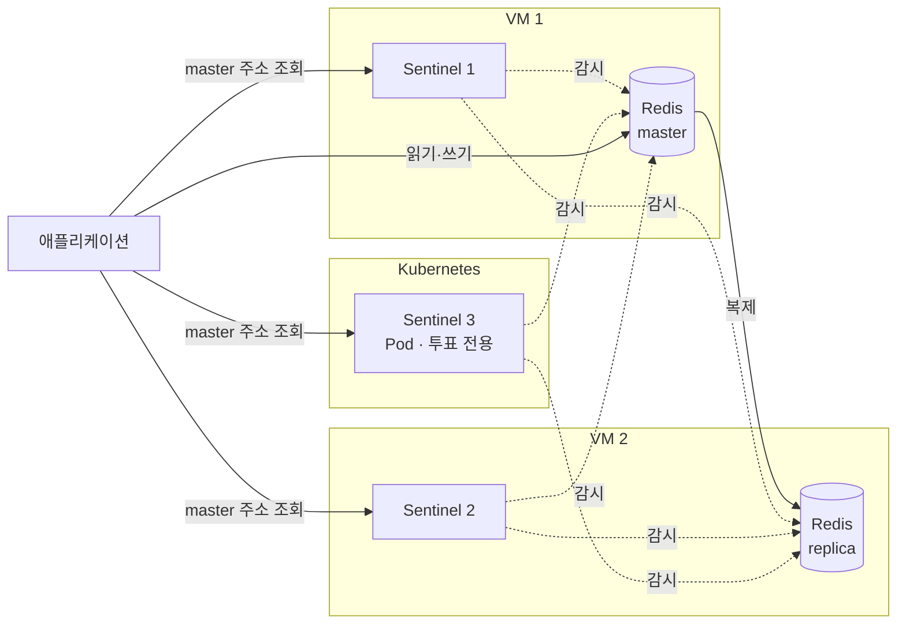

## 들어가며: 서버는 2대, 필요한 건 3표

폐쇄망 환경에서 인프라를 구성하는데 Redis용으로 할당된 VM이 2대뿐이었다. 요구사항은 "Redis가 한 대 죽어도 서비스가 계속 돌아야 한다"였다.

장애 조치(failover)는 결국 **누가 죽었는지 다수결로 정하는 문제**다. 그런데 2대로는 다수결이 성립하지 않는다. 한 대가 죽으면 남은 한 대는 1/2표, 과반이 아니다.

고민 끝에 이렇게 구성했다.

- **VM 2대**: 각각 Redis + Sentinel (master 1, replica 1)
- **쿠버네티스**: Redis 없이 Sentinel만 Pod로 띄워 **투표만** 하게 한다

데이터는 VM에만 있고, 쿠버네티스는 판정에만 참여한다. 이 글은 이 구성을 고른 이유와, 구성하면서 짚어야 했던 함정을 정리한다.

> **기술 스택**: Redis · Redis Sentinel · Kubernetes (ConfigMap, Deployment, hostNetwork) · 폐쇄망 내부 이미지 저장소
{: .prompt-info }

## 왜 Redis Cluster가 아니라 Sentinel인가

"Redis 클러스터"라고 하면 보통 두 가지를 떠올린다.

| 방식 | 목적 | 최소 구성 |
| --- | --- | --- |
| Redis Cluster | 샤딩(데이터 분산) + 고가용성 | master 3개 이상 (권장: master 3 + replica 3) |
| Redis Sentinel | 단일 master의 고가용성 | Sentinel 3개 이상 + Redis 2개 |

Redis Cluster도 master끼리 과반 투표로 장애를 판정하므로 master가 최소 3개 필요하다. 서버 2대에 master 3개를 나눠 담으면, 2개가 올라간 서버가 죽는 순간 과반이 깨진다. 게다가 이번 요구사항은 데이터 분산이 아니라 **죽지 않는 것** 하나였다. 그래서 Sentinel을 택했다.

## 전체 구조



Sentinel 3개가 같은 master를 감시하고 서로를 인식한다. 애플리케이션은 Redis 주소를 직접 들고 있지 않고, Sentinel에게 "지금 master가 누구냐"를 물어 연결한다. 쿠버네티스의 Sentinel은 Redis 데이터를 갖지 않으므로 리소스가 거의 들지 않는다.

## 핵심 설계 결정

### 1. 2개로는 안 된다: quorum과 과반은 다르다

Sentinel 설정에는 `quorum` 값이 있다. 처음엔 "Sentinel 2개에 quorum을 1로 두면 한 대만 남아도 장애 조치가 되지 않을까"라고 생각했다. 되지 않는다.

Sentinel의 장애 조치는 두 단계다.

1. **ODOWN 판정**: master가 죽었다고 보는 Sentinel 수가 `quorum` 이상이면 객관적 다운(ODOWN)으로 본다
2. **리더 선출**: 실제로 failover를 수행할 리더는 **전체 Sentinel의 과반** 표를 받아야 한다

`quorum`은 1단계에만 쓰인다. 2단계는 `quorum`과 무관하게 항상 과반이다. Sentinel이 2개면 과반은 2다. 한 대가 VM과 함께 죽으면 남은 1개는 리더가 될 수 없다.

| Sentinel 구성 | VM 1대 장애 시 남는 표 | 과반 | 장애 조치 |
| --- | ---: | ---: | --- |
| VM에 2개 (quorum 1) | 1 | 2 | 불가 |
| VM에 2개 + 쿠버네티스 1개 (quorum 2) | 2 | 2 | 가능 |

그래서 세 번째 투표자가 필요했다. 문제는 세 번째 서버가 없다는 점이었다.

### 2. 세 번째 표는 이미 있는 쿠버네티스에서 빌린다

같은 폐쇄망에 애플리케이션용 쿠버네티스 클러스터가 이미 있었다. Sentinel은 메모리·CPU를 거의 쓰지 않고 데이터도 저장하지 않는다. 투표만 하는 프로세스를 띄우는 데 새 서버를 요청할 이유가 없었다.

여기서 중요한 조건은 **장애 영역(failure domain)이 달라야 한다**는 것이다. 세 번째 Sentinel이 VM 1이나 VM 2와 같은 물리 호스트에 있으면, 그 호스트가 죽을 때 두 표가 함께 사라진다. 쿠버네티스 노드가 Redis VM과 다른 호스트에 있는지 확인하고 배치했다.

### 3. Sentinel Pod는 VM에서 보이는 주소로 자신을 알려야 한다

Sentinel끼리는 서로의 주소를 Redis의 `__sentinel__:hello` 채널로 주고받는다. 이때 쿠버네티스 Sentinel이 Pod IP를 알리면 두 가지 문제가 생긴다.

- VM에서는 Pod 네트워크로 라우팅이 되지 않는다
- Pod가 재시작되면 IP가 바뀐다

그래서 Pod는 `hostNetwork: true`로 노드 네트워크를 쓰고, `sentinel announce-ip`에 노드 IP를 넣었다. 노드 IP는 Downward API(`status.hostIP`)로 받아 initContainer에서 설정 파일에 써 넣는다.

```yaml
apiVersion: apps/v1
kind: Deployment
metadata:
  name: redis-sentinel-voter
spec:
  replicas: 1
  selector:
    matchLabels: { app: redis-sentinel-voter }
  template:
    metadata:
      labels: { app: redis-sentinel-voter }
    spec:
      hostNetwork: true
      dnsPolicy: ClusterFirstWithHostNet
      initContainers:
        - name: render-config
          image: <내부 저장소>/redis:<버전>
          env:
            - name: NODE_IP
              valueFrom:
                fieldRef: { fieldPath: status.hostIP }
          command: ["sh", "-c"]
          args:
            - sed "s/__ANNOUNCE_IP__/${NODE_IP}/" /config-template/sentinel.conf > /data/sentinel.conf
          volumeMounts:
            - { name: template, mountPath: /config-template }
            - { name: data, mountPath: /data }
      containers:
        - name: sentinel
          image: <내부 저장소>/redis:<버전>
          command: ["redis-sentinel", "/data/sentinel.conf"]
          ports:
            - containerPort: 26379
          volumeMounts:
            - { name: data, mountPath: /data }
      volumes:
        - name: template
          configMap: { name: redis-sentinel-config }
        - name: data
          emptyDir: {}
```

```conf
# sentinel.conf (ConfigMap 템플릿)
port 26379
sentinel announce-ip __ANNOUNCE_IP__
sentinel announce-port 26379
sentinel monitor mymaster <VM1_IP> 6379 2
sentinel down-after-milliseconds mymaster 5000
sentinel failover-timeout mymaster 60000
sentinel parallel-syncs mymaster 1
```

설정 파일을 ConfigMap에서 바로 쓰지 않고 emptyDir로 복사한 데는 이유가 있다. 아래 트러블슈팅에서 다룬다.

### 4. 애플리케이션은 Redis가 아니라 Sentinel에 연결한다

failover가 일어나면 master의 IP가 바뀐다. 애플리케이션이 VM 1의 IP를 직접 들고 있으면 장애 조치가 성공해도 서비스는 죽은 서버에 계속 붙는다. 애플리케이션 설정은 Redis 주소 대신 Sentinel 3개의 주소와 master 이름(`mymaster`)으로 바꿨다. Sentinel을 지원하는 클라이언트는 master 주소를 조회하고, failover 알림을 받으면 새 master로 다시 연결한다.

## 구성하며 짚은 함정

### Sentinel은 설정 파일을 직접 고쳐 쓴다

Sentinel은 실행 중에 알게 된 다른 Sentinel, replica, 현재 master 정보를 **자기 설정 파일에 다시 쓴다.** ConfigMap을 그대로 마운트하면 읽기 전용이라 Sentinel이 시작 직후 설정을 저장하지 못하고 종료된다.

해결은 위 매니페스트처럼 ConfigMap은 템플릿으로만 두고, initContainer가 쓰기 가능한 emptyDir로 복사해서 그 파일로 실행하는 것이다. 이렇게 하면 Pod가 재시작될 때마다 템플릿에서 깨끗하게 다시 시작한다.

### 죽은 Sentinel을 다른 Sentinel이 잊지 않는다

Sentinel은 한 번 알게 된 다른 Sentinel을 스스로 지우지 않는다. 쿠버네티스 Sentinel이 다른 노드로 옮겨져 announce-ip가 바뀌면, VM의 Sentinel들은 예전 주소의 Sentinel을 계속 "전체 인원"에 포함한다. 전체가 4개로 늘어난 것처럼 보이면 과반도 3으로 올라가, VM 하나가 죽었을 때 장애 조치가 되지 않는다.

`SENTINEL SENTINELS mymaster`로 인식 중인 목록을 확인하고, 주소가 바뀐 뒤에는 각 Sentinel에 `SENTINEL RESET mymaster`를 하나씩 순서대로 실행해 목록을 다시 쌓게 했다. 애초에 주소가 바뀌지 않도록 Pod가 뜰 노드를 고정하는 방법도 있다.

### VM 하나만 고립되면 master가 둘이 된다

VM 1(master)이 네트워크에서만 고립되고 살아 있는 경우를 생각해야 한다. VM 2와 쿠버네티스의 Sentinel 두 표로 VM 2가 새 master가 된다. 그런데 VM 1에 아직 붙어 있는 클라이언트는 옛 master에 계속 쓴다. 네트워크가 돌아오면 VM 1은 replica로 강등되고, 그동안 쓴 데이터는 사라진다.

이를 줄이는 설정이 `min-replicas-to-write`다.

```conf
# redis.conf (VM 1, VM 2 공통)
min-replicas-to-write 1
min-replicas-max-lag 10
```

replica가 10초 넘게 응답하지 않으면 master가 쓰기를 거부한다. 고립된 옛 master는 곧 쓰기를 멈추므로 잃는 데이터가 그 시간 안으로 제한된다.

다만 replica가 하나뿐인 구성에서는 대가가 분명하다. **VM 2만 죽어도 VM 1이 쓰기를 거부한다.** 데이터 유실을 막는 대신 쓰기 가용성을 내주는 거래다. 캐시처럼 유실을 감수할 수 있는 용도인지, 유실되면 안 되는 데이터인지에 따라 켤지를 정해야 한다.

### 폐쇄망에서는 이미지도 준비물이다

쿠버네티스에 Sentinel을 띄우려면 Redis 이미지가 내부 저장소에 있어야 한다. VM에 설치한 Redis와 같은 버전의 이미지를 반입해 두었다. Sentinel 간 프로토콜은 버전 차이에 관대한 편이지만, 장애 상황에서 버전 차이를 의심해야 하는 변수를 하나 더 만들 필요는 없었다.

## 검증

구성 후 확인한 항목은 다음과 같다.

1. 각 Sentinel에서 `SENTINEL SENTINELS mymaster`가 나머지 2개를, `SENTINEL REPLICAS mymaster`가 replica 1개를 보여 주는지
2. VM 1의 Redis를 멈췄을 때 VM 2가 master로 승격되고, 애플리케이션이 새 master로 다시 붙는지
3. VM 1을 다시 올렸을 때 replica로 합류하는지
4. 쿠버네티스 Sentinel Pod를 지웠을 때 재생성 후 다른 Sentinel이 다시 인식하는지

failover에 걸리는 시간은 `down-after-milliseconds`(장애 판정 대기)와 선출·승격 시간을 더한 값이다. 판정 대기를 짧게 줄이면 빨라지지만 일시적인 네트워크 지연에도 failover가 일어날 수 있어 기본값보다 크게 줄이지 않았다.

## 회고

### 아직 남은 것

- **replica가 하나뿐이다.** 한 대가 죽은 동안에는 이중화가 없는 상태로 운영된다. 복구 전까지 또 하나가 죽으면 끝이다
- **쿠버네티스 가용성에 기댄다.** 쿠버네티스 클러스터 전체가 내려가면 VM 2대가 멀쩡해도 2표 중 2표가 필요하므로, 그 상태에서 VM 하나가 더 죽으면 장애 조치가 되지 않는다

### 배운 것

1. **고가용성은 서버 수가 아니라 투표자 수의 문제다.** 데이터를 가진 노드는 2개로 충분했다. 부족했던 건 판정에 참여할 세 번째 표였고, 그 표는 데이터를 가질 필요가 없었다.
2. **quorum과 과반은 다르다.** quorum을 낮춰서 투표자 부족을 메울 수 없다. 이 차이를 모르면 설정은 맞아 보이는데 실제 장애에서 아무 일도 일어나지 않는다.
3. **분산 시스템의 구성원은 "보이는 주소"로 이야기해야 한다.** 쿠버네티스 안과 밖이 섞이면 Pod IP는 바깥에서 의미가 없다. announce 설정을 놓치면 정상처럼 보이다가 장애 때 드러난다.
4. **장애 시나리오를 표로 먼저 그려 본다.** "어느 노드가 죽으면 몇 표가 남는가"를 미리 적어 두니 구성의 약점(고립된 master, 쿠버네티스 장애)이 설계 단계에서 보였다.
