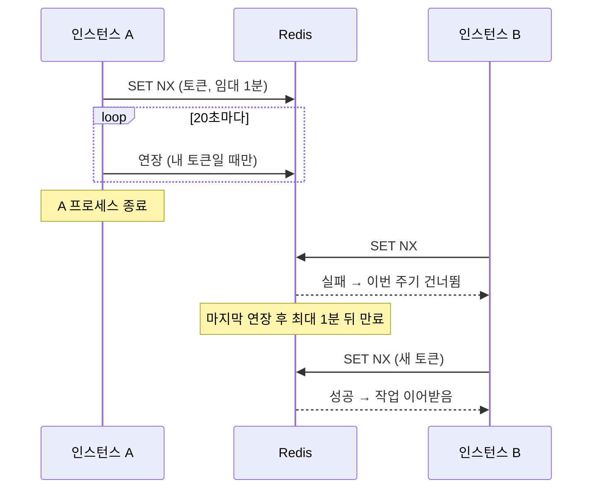

## 들어가며: 락을 30분 잡아야 하는 작업

Spring Boot 서비스 여러 인스턴스가 같은 `@Scheduled` 작업을 돌린다. Elasticsearch 증분 색인(10분 주기), 자동완성 사전 재생성(5분 주기), 수동 전건 재색인이다. 두 인스턴스가 같은 색인을 동시에 돌리면 원본 DB 조회가 배로 늘고, 증분 기준점을 서로 앞당겨 아직 색인하지 않은 구간을 건너뛸 수 있다. 그래서 Redis `SET NX`로 작업별 락을 걸었다.

처음 구현은 흔한 형태였다. 락을 예상 실행 시간만큼 TTL로 잡고, 끝나면 `DEL` 한다. 전건 색인까지 감안해 TTL은 30분이었다.

```java
redis.opsForValue().setIfAbsent(key, "1", Duration.ofMinutes(30));
try { task.run(); } finally { redis.delete(key); }
```

이 코드는 평소엔 잘 돈다. 문제는 두 가지 예외 상황이다.

- 락을 쥔 인스턴스가 죽으면 남은 TTL 내내, 최대 30분 동안 그 작업을 아무도 돌리지 못한다.
- 그렇다고 TTL을 짧게 잡으면 작업이 TTL보다 오래 걸릴 때 락이 먼저 풀려 중복 실행된다.

변경분이 없으면 금방 끝나고 전건 색인으로 돌아가면 수십 분까지 걸리는 작업에는 두 조건을 동시에 만족하는 TTL이 없다. 이 글은 이 딜레마를 **짧은 임대(lease) + 자동 연장** 방식으로 풀어낸 과정이다.

> **기술 스택**: Java · Spring Boot · Spring Data Redis(`StringRedisTemplate`, `DefaultRedisScript`) · Redis Lua · JUnit 5 · Mockito
{: .prompt-info }

## 한 장으로 보기

바뀐 것은 하나다. **락을 쥔 인스턴스가 죽었을 때, 락이 주인 없이 남는 시간**이다.



고정 TTL에서는 죽은 시점부터 TTL이 끝날 때까지 작업이 멈춘다. 임대 방식에서는 마지막 연장으로부터 최대 1분 뒤에 락이 풀린다. 작업이 길어지면 그만큼 연장이 이어지므로 중복 실행 위험도 늘지 않는다.

## 핵심 설계 결정 4가지

### 1. 락은 짧게 빌리고, 살아 있는 동안만 연장한다

TTL의 의미를 바꿨다. 예전에는 "작업이 끝날 때까지 필요한 시간"이었다. 지금은 **"인스턴스가 죽었을 때 락이 풀리기까지의 최대 지연"**이다.

| 상수 | 값 | 의미 |
| --- | --- | --- |
| `LEASE` | 1분 | 한 번에 빌리는 시간. 죽은 인스턴스의 락이 남는 최대 시간 |
| `RENEW_INTERVAL` | 20초 | 연장 주기. 임대의 1/3로 두어 연장을 한 번 놓쳐도 임대가 끊기지 않음 |
| `maxHold` | 작업별 10~30분 | 연장을 멈추는 상한. 아래 3번 |

연장은 작업 스레드가 아니라 별도 데몬 스레드(`ScheduledExecutorService`)가 맡는다. 작업 코드는 락의 존재를 모른 채 `Runnable`만 넘기면 된다. 작업이 끝나면 `finally`에서 연장을 취소하고 즉시 해제해, 다음 주기가 임대 만료를 기다리지 않게 했다.

```java
ScheduledFuture<?> renewal = scheduleRenewal(job, key, token, Instant.now().plus(maxHold));
try {
    task.run();
    return true;
} finally {
    renewal.cancel(false);
    release(job, key, token);
}
```

### 2. 해제와 연장은 "내 락일 때만": 소유자 토큰 + Lua

락 값을 `"1"` 대신 획득할 때마다 만드는 UUID 토큰으로 바꿨다. 해제와 연장은 "값이 내 토큰과 같을 때만" 실행한다. `GET`으로 확인한 뒤 `DEL`을 따로 보내면 그 사이에 다른 인스턴스가 락을 잡을 수 있다. 그래서 두 동작을 Lua 스크립트 하나로 묶어 Redis에서 원자적으로 실행한다.

```lua
-- 연장
if redis.call('get', KEYS[1]) == ARGV[1] then
    return redis.call('pexpire', KEYS[1], ARGV[2])
end
return 0
```

```lua
-- 해제
if redis.call('get', KEYS[1]) == ARGV[1] then
    return redis.call('del', KEYS[1])
end
return 0
```

연장 스크립트가 0을 돌려주면 이미 소유권을 잃었다는 뜻이다. 이때는 "다른 인스턴스가 같은 작업을 시작했을 수 있다"는 경고를 남긴다.

### 3. 연장에도 상한을 둔다: maxHold

자동 연장에는 새 위험이 있다. 프로세스는 살아 있는데 작업이 어딘가에서 매달려 끝나지 않으면, 연장 스레드는 락을 영원히 붙든다. 그래서 작업마다 최대 보유 시간을 받고, 그 시간을 넘기면 연장을 멈춘다. 그러면 최대 1분 뒤 다른 인스턴스가 이어받을 수 있다. 값은 예상 실행 시간의 2~3배로 뒀다. 자동완성 재생성은 10분, 증분·전건 색인은 30분이다.

결국 예전 TTL이 맡던 역할을 둘로 나눈 셈이다. "죽은 인스턴스 복구"는 1분 임대가, "매달린 작업 차단"은 `maxHold`가 맡는다.

### 4. 기다리지 않고, Redis가 죽어도 멈추지 않는다

- **락을 못 잡으면 기다리지 않고 건너뛴다.** 주기 작업은 다음 주기에 다시 돈다. 기다리면 스케줄러 스레드가 묶여 같은 풀의 다른 작업까지 밀린다. 반환값 `boolean`으로 실행 여부를 알려, 수동 재색인 요청이 무시됐을 때 경고를 남길 수 있게 했다.
- **Redis 장애 시에는 락 없이 실행한다(fail-open).** 이 락은 중복 실행을 줄이는 최적화 수단이지 정합성을 보증하는 수단이 아니다. 예외를 그대로 던지면 Redis 장애가 곧 배치 전면 중단이 된다.
- **이 판단이 가능한 이유는 작업이 멱등하기 때문이다.** 색인 문서 ID가 원본 키로 고정돼 있어, 같은 문서를 두 번 넣어도 덮어쓰기가 된다. 중복 실행의 비용은 DB 부하 정도로 끝난다.

락 키는 작업 단위로 나눈다. 색인은 카테고리별로 `index:{category}`를 써서 한 원본의 색인이 길어져도 다른 원본이 밀리지 않는다. 주기 증분 색인과 수동 전건 재색인은 같은 키를 공유해서 둘이 겹치지 않는다.

## 트러블슈팅: 조용히 틀리는 락

락 버그는 에러를 내지 않는다. 작업이 조용히 안 돌거나, 조용히 두 번 돈다.

### 인스턴스 하나가 죽으면 색인이 30분간 멈춘다

- **증상**: 배포나 장애로 락을 쥔 인스턴스가 죽으면, 나머지 인스턴스는 매 주기 "다른 인스턴스가 실행 중"이라며 건너뛴다. 에러 로그는 없다.
- **원인**: TTL 30분짜리 락이 주인 없이 남아 있다.
- **해결**: 1분 임대 + 20초 연장. 연장하던 프로세스가 사라지면 락도 최대 1분 안에 풀린다. 죽은 인스턴스의 락이 남는 시간이 설계상 30분에서 1분으로 줄었다.

### 끝난 작업이 남의 락을 지운다

- **상황**: A가 락을 잡고 작업한다. 작업이 길어지거나 연장이 실패해 임대가 끝난다. B가 같은 키로 락을 새로 잡는다. 그때 A가 끝나며 `DEL`을 보낸다.
- **결과**: B가 아직 일하는데 락이 사라진다. C까지 들어오면 중복 실행이 연쇄된다. 어느 단계에서도 예외는 나지 않는다.
- **해결**: 소유자 토큰을 비교하는 Lua 해제. 단위 테스트에서 해제가 토큰 비교 스크립트로만 일어나고 `delete()`는 한 번도 호출되지 않는지 검증한다.

### 잡지 못한 락을 해제하려 한다

- **상황**: Redis 장애로 획득 자체가 실패해 락 없이 실행했다. 작업이 끝난 뒤 해제를 시도한다.
- **위험**: 그 사이 Redis가 복구되고 다른 인스턴스가 락을 잡았다면, 무조건 삭제는 그 락을 지운다.
- **해결**: 획득 실패 경로는 작업만 실행하고 바로 반환한다. 해제·연장 단계에 아예 들어가지 않는다. 테스트 "Redis가 죽어 있어도 작업은 실행하고, 스크립트는 호출하지 않는다"로 고정했다.

### Redis 키 이름만 바꿨는데 전건 재색인이 돈다

락을 바꾸면서 Redis 키를 `{service}:{domain}:{purpose}:{id}` 규칙으로 정리했다. 그런데 같은 Redis에 증분 색인의 기준점(워터마크)도 있었다. 키가 바뀌면 새 키에는 기준점이 없고, 서비스는 기준점이 없으면 전건 색인으로 돌아간다.

배포 직후 첫 주기에 전건 색인이 한 번 돈다는 점을 미리 파악하고 그대로 배포했다. 문서 ID가 원본 키로 고정이라 중복이 생기지 않기 때문이다. 키 이름 변경도 상태 마이그레이션이라는 것, 그리고 멱등성이 있으면 그 비용이 "한 번 더 도는 것"으로 끝난다는 것을 보여 주는 사례다.

## 회고: 남은 한계와 배운 것

### 이 락이 막지 못하는 것

- **펜싱이 없다.** 연장이 실패해 소유권을 잃어도 실행 중인 작업은 멈추지 않는다. 경고 로그만 남긴다. GC 멈춤이나 네트워크 지연으로 연장이 늦으면 짧게 두 인스턴스가 동시에 돌 수 있다. 쓰기 쪽에서 소유권을 다시 확인하는 대신 작업의 멱등성에 기대었다.
- **Redis 장애 조치 상황은 다루지 않았다.** 키 하나에 `SET NX`를 거는 방식이라, 복제 지연 중에 마스터가 바뀌면 락이 사라질 수 있다. Redlock 같은 다중 노드 알고리즘은 도입하지 않았다. 멱등한 주기 작업에는 과하다고 봤다.
- **연장 경로는 테스트가 없다.** 단위 테스트 4개(획득·해제, 이미 잡힌 락 건너뛰기, Redis 장애 시 실행, 예외 후 해제)는 Mockito로 Redis를 대신한다. 실제 시간이 흘러야 하는 연장과 `maxHold` 동작, 실제 Redis에서의 동시 획득 경합은 검증하지 않았다. 다시 한다면 시계를 주입할 수 있게 만들고 Testcontainers로 실제 Redis 테스트를 붙이겠다.
- **30분에서 1분은 설계 값이다.** 운영에서 장애 복구 시간을 측정한 값은 아니다.

### 배운 것

1. **TTL 하나에 두 역할을 싣지 않는다.** "죽은 노드 복구"와 "매달린 작업 차단"은 요구하는 시간이 다르다. 짧은 임대와 최대 보유 상한으로 나누자 값을 정하는 고민이 사라졌다.
2. **락은 토큰으로 소유한다.** "키가 있다"는 "내가 가지고 있다"와 같지 않다. 확인과 변경은 Lua로 묶어 원자적으로 처리한다.
3. **락의 역할을 먼저 정한다.** 중복 실행을 줄이는 최적화인지, 정합성을 지키는 장치인지에 따라 Redis 장애 때 동작(fail-open/fail-closed)이 달라진다. 이번에는 작업을 멱등하게 만들고 락을 최적화 수단으로 두었기 때문에 나머지 한계들을 받아들일 수 있었다.
4. **락이 필요 없는 구조도 답이다.** 이후 색인을 애플리케이션 스케줄러에서 별도 배치로 옮기면서 이 락은 코드에서 사라졌다. 실행 주체가 하나면 애초에 다투지 않는다.
