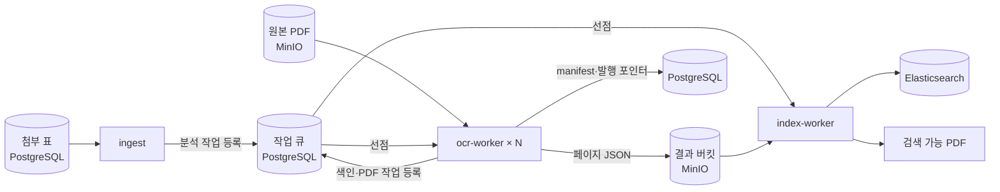

## 들어가며: PDF는 많은데 검색이 안 된다

업무 시스템에는 수년간 업로드된 첨부 PDF가 쌓여 있다. 문제는 이 중 상당수가 스캔본이거나, 머리말만 텍스트이고 본문은 이미지인 혼합 문서라는 점이다. 파일은 있어도 본문의 단어를 검색해도 나오지 않는다.

그래서 만든 것이 document-indexer다. DB의 첨부 표에 등록된 PDF를 MinIO에서 읽어 OCR과 구조 분석을 하고, 결과를 두 가지로 돌려준다.

- **페이지 단위 원문 검색 + 좌표 하이라이트**: 검색어가 PDF의 어느 쪽 어느 위치에 있는지 표시
- **검색 가능 PDF**: 원본 모양은 그대로 두고 투명 텍스트 레이어만 넣은 PDF

이 글은 OCR 모델을 붙이는 이야기보다는 OCR을 몇만 쪽 단위로 끊김 없이 돌리는 배치 파이프라인을 어떻게 설계했는지에 집중한다. 실제로 시간이 가장 많이 든 곳도 모델이 아니라 이 부분이었다.

> **기술 스택**: Python 3.12 · PaddleOCR 3.7 (PP-OCRv5 한국어 인식, PP-DocLayout_plus-L) · paddlepaddle 3.2.2 · PyMuPDF · PostgreSQL · MinIO · Elasticsearch(Nori) · Docker Compose · Jenkins
{: .prompt-info }

## 전체 구조

파이프라인은 수집(ingest), 분석(ocr-worker), 색인(index-worker) 세 역할로 나뉘고, 서로 PostgreSQL 작업 큐로만 이야기한다.

기준 데이터는 결과 버킷의 페이지 JSON과 DB의 manifest·발행 포인터 두 곳뿐이다. ES 인덱스가 날아가도 재색인으로, PDF가 깨져도 재생성으로 복구되며 OCR을 다시 돌리지 않는다. 반대로 결과 버킷만으로는 전체 복구가 안 되므로 백업 지점은 결과 버킷과 DB 두 곳이다.

## 핵심 설계 결정 4가지

### 1. 모든 쪽을 OCR하지 않는다: 페이지 판정

전자 문서는 PDF에 이미 글자가 들어 있다. 이걸 버리고 OCR하면 느리고 오히려 부정확하다. 그래서 페이지마다 세 가지 중 하나로 판정한다.

| 판정 | 내장 텍스트 | 렌더·OCR |
| --- | --- | --- |
| `use_pdf_text` | 사용 | 생략 |
| `ocr_supplement` | 사용 + OCR로 보완 | 수행 |
| `ocr_required` | 버림 | 수행 |

글자 수, 의미 있는 문자 비율, 텍스트 면적을 본다. 까다로운 건 혼합 페이지였다. 머리말은 텍스트라 "글자가 충분하다"고 판정되지만 본문은 스캔 이미지다. 그래서 본문 이미지 안에 텍스트가 없는 빈 구간이 있는지를 함께 본다.

처음 기준(이미지 폭 40%·높이 20%·면적 20%)은 높이 10~15%짜리 스캔 띠를 거의 놓쳤다. 실제 문서 표본 2,899개(23,198쪽)로 후보 값을 훑어 폭 15%·높이 5%·면적 2%로 낮췄다. 새로 OCR 대상이 된 쪽의 95~100%에서 내장 텍스트에 없던 글자가 나왔고, 대가는 렌더 쪽 약 3.8%p 증가였다. 감이 아니라 `experiments/image_gap_sweep.py`로 재현 가능한 실험으로 임계치를 정했다는 게 포인트다.

PDF 텍스트와 OCR 결과가 겹치면 PDF 텍스트를 우선하고, 겹친 PDF 줄의 글자로 설명되는 OCR 조각은 버린다. 같은 문장이 두 번 색인되는 걸 막기 위해서다.

### 2. 역할을 나누고, 병렬화는 문서 단위로

단일 프로세스로 돌리면 큰 문서를 OCR하는 동안 수집·색인이 멈춘다. 그래서 Compose에서 역할을 분리했다.

- **ingest (1개만)**: 첨부 표 대조, 신규·변경·누락 판정, 만료된 작업 회수
- **ocr-worker (N개)**: 분석 작업 선점 → 페이지별 저장 → 검증·발행
- **index-worker**: ES 색인과 검색 가능 PDF 생성. OCR 엔진을 아예 로드하지 않는다

작업 큐는 별도 브로커 없이 PostgreSQL이다. `FOR UPDATE SKIP LOCKED`로 선점하고 임대 소유자·만료 시각으로 동시성을 제어한다. 워커가 죽으면 임대가 만료되고, ingest가 작업을 다시 `pending`으로 돌린다. 페이지마다 체크포인트를 커밋하므로 300쪽 문서가 280쪽에서 죽어도 281쪽부터 이어간다.

### 3. 발행은 한 트랜잭션, 결과는 불변

분석 결과가 반만 만들어진 채로 검색에 노출되면 안 된다. 순서는 다음과 같다.

1. 페이지 JSON을 결과 버킷에 저장하고 페이지별 체크포인트를 커밋한다
2. 전 페이지의 sha256·크기·좌표·문자 오프셋을 `ResultValidator`로 검증한다
3. manifest 저장과 발행 포인터(현재·직전 run) 교체를 하나의 DB 트랜잭션으로 처리한다
4. 색인·PDF 작업을 등록한다

발행된 결과는 덮어쓰지 않는다. 재처리는 새 run을 만들고, 포인터는 "current가 기대한 run일 때만" 바꾸는 비교 후 교체다. 실패하면 기존 발행본이 그대로 남는다. Elasticsearch와 검색 가능 PDF는 이 결과에서 언제든 다시 만들 수 있는 파생물로 취급한다.

### 4. 엔진은 포트 뒤에 숨긴다

핵심 계층은 PaddleOCR 타입을 모른다. `TextRecognizer`·`LayoutAnalyzer`·`TableRecognizer`를 각각 포트로 두고, 어댑터가 공통 `PageAnalysis` 모델로 변환한다. 의존 방향(domain ← application ← adapters)은 `tests/test_architecture.py`가 테스트로 강제한다. 덕분에 RapidOCR 같은 다른 엔진을 서비스 코드 수정 없이 별도 벤치로 비교할 수 있었다.

## 트러블슈팅: 조용히 틀리는 문제들

OCR 파이프라인에서 가장 위험한 버그는 죽는 버그가 아니라 죽지 않고 느려지거나 결과가 미묘하게 틀리는 버그였다.

### 버전을 올렸더니 OCR이 2~3배 느려졌다

paddlepaddle 3.3.x에서는 텍스트 검출 모델이 oneDNN 경로에서 죽는다([Paddle #77340](https://github.com/PaddlePaddle/Paddle/issues/77340)). 어댑터가 이를 피해 검출 oneDNN을 자동으로 끄도록 되어 있었는데, 그 결과 프로세스는 멀쩡하지만 텍스트 OCR이 2~3배 느려졌고 로그에는 아무것도 남지 않았다.

해결은 3.2.2 고정이다. 요구사항 파일에 이유를 주석으로 남기고, 판단 기준은 코드 상수(`DETECTION_ONEDNN_BROKEN_SINCE`)로 뒀다. 실제 엔진을 쓰는 `engine` 마커 테스트는 변경 시 반드시 돌리도록 했다.

### 로컬에서는 되는데 컨테이너에서만 죽는다

paddleocr는 `paddlex[ocr-core]`만 끌고 온다. 표 인식 파이프라인(`TableRecognitionPipelineV2`)은 더 넓은 `[ocr]` extra가 필요했는데, 개발자 venv에는 따로 설치돼 있어 문제가 보이지 않았다. `pyproject.toml`만 보고 만드는 컨테이너 이미지에서만 `DependencyError`가 났다.

이후 하위 의존성까지 운영 이미지와 같은 버전으로 묶는 `constraints.txt`를 도입하고, 의존성이 바뀐 커밋은 깨끗한 체크아웃에서 다시 검증한다. 모델을 포함한 무거운 베이스 이미지는 분리해 체크섬으로 관리한다.

### OCR은 맞게 읽었는데 검색이 안 된다

원문의 글머리 `○`가 OCR에서 한글 자모 `ㅇ`으로 읽히고 첫 단어에 붙어 나왔다. Nori 형태소 분석기는 이를 `ㅇ+단어`라는 하나의 토큰으로 자르기 때문에, 글자는 다 맞는데 첫 단어가 검색되지 않았다.

노이즈 제거 뒤에 글머리를 띄우는 규칙을 넣고 `OCR_BULLET_RULE_VERSION`을 두었다. 규칙 버전이 처리 설정 지문에 들어가므로, 규칙을 바꾸면 어떤 문서가 재처리 대상인지 자동으로 구분된다. 숫자도 비슷한 문제가 있어, 숫자 사이의 쉼표·점·공백·하이픈을 제거한 정규화 필드를 따로 두되 표의 서로 다른 셀 값이 하나의 숫자로 합쳐지지 않도록 줄바꿈은 보존했다.

### 큰 문서에서 메모리가 터진다

발행 전 검증은 모든 페이지 JSON을 읽는다. 처음엔 한 번에 메모리에 올렸는데, 최대 8쪽·manifest 크기 기준 8 MiB씩 묶어 읽고, 해석한 모델은 호출 범위의 임시 파일에 둔 뒤 필요한 쪽만 읽도록 바꿨다.

**측정 (합성 결과, 구조 계측)**

| 항목 | 개선 전 | 개선 후 |
| --- | ---: | ---: |
| 검증·검색 투영 피크 RSS, 1,000쪽 (JSON 약 80 MiB) | 218.71 MiB | 36.77 MiB |
| 같은 작업 소요 시간, 1,000쪽 | 1.918초 | 2.299초 |
| 피크 RSS, 6,000쪽 (JSON 약 481 MiB) | - | 39.18 MiB |
| 내장 텍스트 추출 중앙값 (이미지 바이트 보존 끔) | 155.467 ms | 1.621 ms |

시간을 조금 내주고 메모리를 쪽 수에 거의 무관하게 만든 거래다. 두 번째 항목은 PyMuPDF가 텍스트만 필요한데도 이미지 바이트를 보존하던 플래그 하나를 끈 결과다.

> 어느 것도 실제 OCR 엔진·네트워크를 포함한 종단 측정은 아니다.
{: .prompt-warning }

### 재처리 중 같은 페이지가 두 번 보인다

새 run을 색인하고 이전 run을 끄는 사이에는 짧게 두 버전이 다 활성인 순간이 있다. ES에는 여러 문서에 걸친 원자적 전환이 없기 때문이다. 검색 쿼리에 `collapse: page_key`를 걸고 동점이면 최신 run을 우선하도록 해서 전환 중에도 한 페이지는 한 번만 보이게 했다. 중간에 실패하면 같은 전환을 다시 시도해 수렴시킨다.

## 회고: 남은 것과 배운 것

### 아직 끝나지 않은 것

솔직하게 적으면, 인식률을 숫자로 주장할 근거는 아직 없다. 사람이 직접 전사한 정답셋이 없기 때문이다. 내장 텍스트를 대용 정답으로 쓴 실험이나 엔진 간 문자열 일치율은 있지만, 렌더 이미지가 실제 스캔보다 깨끗해서 정확도가 낙관적으로 나온다. 그래서 CER 측정 도구와 정답셋 양식까지만 만들어 두고 "정확도 개선"이라고 쓰지 않았다.

- **한자**: 한국어 모델 문자 사전에 한자가 없다. 한자가 빠져도 신뢰도는 높게 나와서 저신뢰 필터로는 찾을 수 없다. 중국어 모델로 바꾸면 한글이 손실된다
- **읽기 순서**: 레이아웃 모델이 순서를 예측하지 않아 두 단 본문·각주는 검증이 필요하다
- **혼합 페이지 보완**: 지금은 페이지 전체를 OCR한다. 영역별 OCR은 미구현이다
- **운영 용량**: 서버 사양·GPU 여부·목표 처리량이 미정이라 워커·스레드 수의 최적값을 아직 정하지 않았다

### 배운 것

1. **OCR 파이프라인의 난이도는 모델보다 상태 관리에 있다.** 어느 지점에서 죽어도 이어서 할 수 있고, 반쯤 만든 결과가 노출되지 않게 만드는 일에 대부분의 시간이 들었다. 새 외부 부작용을 추가할 때는 체크포인트·멱등 키·재개 위치부터 정의한다는 규칙을 두었다.
2. **임계치는 실험으로 정하고, 실험은 저장소에 남긴다.** 혼합 페이지 기준처럼 숫자 하나를 바꾼 이유를 누구나 다시 돌려볼 수 있어야 다음 사람이 그 값을 건드릴 수 있다.
3. **측정한 것과 측정하지 않은 것을 구분해서 말한다.** 합성 스모크 테스트의 수치를 운영 용량이나 실문서 정확도로 포장하지 않는 것이 장기적으로 신뢰를 지킨다.
4. **조용한 실패를 테스트로 막는다.** 엔진 버전·의존성·계층 경계처럼 깨져도 아무도 모르는 것일수록 테스트와 코드 상수로 박아 두었다.
